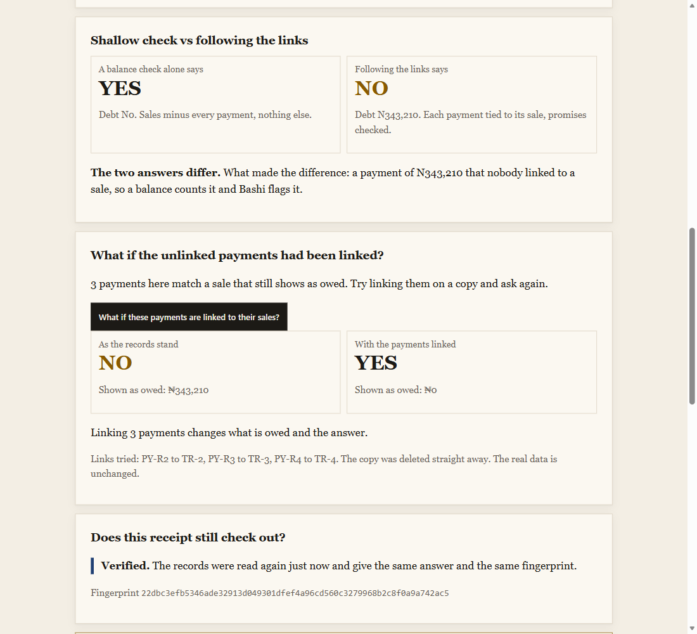
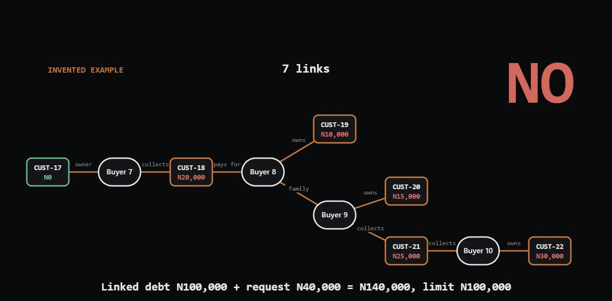
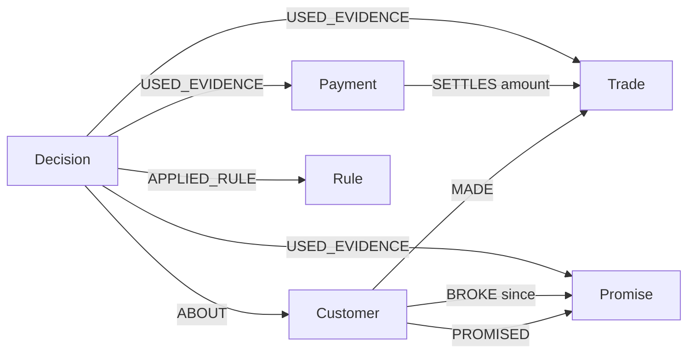

Live demo: https://bashi-vrfv.onrender.com (no sign-up)
Demo video: https://youtu.be/Xpq_LN4h9XA
More for judges: [JUDGES.md](JUDGES.md)

# Bashi



*The real audit case on the live site: the same customer, NO with the 3 payments unlinked and YES once they are linked on a copy. The real data is never changed.* On the 70 sealed cases that depend on those links (unlinked payment, money paid before the sale, split payments, someone else paying), an AI with the same records but no graph got 46 right and Bashi got 70 (`sealed/RESULTS_LLM.md`).



*Invented example, drawn for this README (not a screenshot of the site): alone this customer owes N0, but 7 links away 5 linked accounts owe N100,000, so Bashi says NO.*

Checking CUST-17 alone, 1 link: YES, owes N0. Walking 7 links: NO, 5 linked accounts owe N100,000.

**My shop's ledger said customers owed N388,340 they had already paid.** In my audit of 17 July 2026, 8 credit sales were marked paid while the customer's ledger still showed the debt. Each screen looked right on its own, so nobody saw it. Bashi follows each sale to its payments in a graph, flags the gap, answers yes or no on credit, and gives a receipt anyone can check. Press "See the real audit case" on the live site to see those 8 sales.

**Entered in Track 01, Agents That Act on Connected Data. This is the one track I want judged.**

**What the graph does here that a balance check cannot.** A balance check adds up what a customer owes and stops. It cannot see that a payment cleared a particular sale, or that the same customer broke a promise to pay. Bashi walks those links in FalkorDB: customer, to sales, to payments, to promises. On 255 test cases whose answers I locked before running anything (55, then 200 new), Bashi wrongly approved 0 and a balance check wrongly approved 53 (14 of the first 55, 39 of the next 200). The files are `sealed/RESULTS.md` and `sealed/RESULTS_B.md`. Plus 30 locked family-network cases with chains up to 22 links: Bashi 30 of 30; checking the asking account alone wrongly approves 11, and an AI given the same records without the graph gets 19 of 30, mostly by refusing customers who should get credit (`sealed/RESULTS_LLM_FAMILY.md`) (`sealed/RESULTS_FAMILY.md` for set F, 20 cases, and `sealed/RESULTS_FAMILY_G.md` for set G, 10 cases). I wrote those cases myself, so it shows the situations Bashi was built for, not accuracy on every shop. Take FalkorDB away and Bashi answers nothing.

**Against an AI with no graph.** I gave an AI model (Gemini Flash Lite, temperature 0) the same 200 locked cases as a flat list of sales, payments and promises with the same rules, just no links. It got 152 right and wrongly approved 23, worth N3,685,003 of credit. Bashi got 200 right with 0 wrong approvals. The AI did spot every broken promise; its misses were reading and arithmetic slips, which is the point: the same records, read without the links, give answers you can't rely on. Every answer is saved in `sealed/RESULTS_LLM.md` and the JSON files beside it.

## Ways to use Bashi

| Way | How |
|---|---|
| Website | https://bashi-vrfv.onrender.com, no sign-up. |
| MCP (a standard way for AI tools to call other tools) | `https://bashi-vrfv.onrender.com/mcp`. Works in Cursor and other AI tools that take an MCP address. Five tools: `decide_credit`, `get_receipt`, `verify_decision`, `what_if_remove_evidence`, `list_customers`. |
| Claude Desktop | One-click extension: [extension/Bashi.mcpb](extension/Bashi.mcpb), steps in [extension/INSTALL.md](extension/INSTALL.md). |
| Web API | `/api/decide`, `/api/receipt`, `/api/verify`, `/api/whatif`, `/api/customers`. See [AGENTS.md](AGENTS.md). |
| Guides an AI can read | `/llms.txt` and `/AGENTS.md` on the live site. |
| Your own shop | Three CSV files, or three published Google Sheet tabs, loaded into your own FalkorDB from the command line. It never writes to the public demo. See "Use it on your own shop" below. |

## Family network: 7 links deep

All data in this section is invented. Ask the own shop view for **CUST-17**, N40,000. CUST-17 alone owes N0, so a plain balance check says YES. Bashi says **NO**, because it follows the people behind the account: CUST-17 is owned by Buyer 7, who collects goods for CUST-18 (owes N20,000). Buyer 8 pays for CUST-18 and owns CUST-19 (N10,000). Buyer 8 is family of Buyer 9 (link FAM-1). Buyer 9 owns CUST-20 (N15,000) and collects for CUST-21 (N25,000). Buyer 10 also collects for CUST-21 and owns CUST-22 (N30,000). This account and 5 linked accounts owe N100,000 in total, plus the request N40,000 is N140,000, above the limit N100,000.

The third rule, in plain words: when people link this account to others (its owner, the people who collect or pay for it, their family), say NO if the open debt across every linked account plus the new request is above this customer's credit limit. Accounts with no people links behave exactly as before. It is one graph walk of up to 20 links, about 0.3 seconds.

Press the what-if on family link FAM-1: on a throwaway copy of the graph it is removed, and the answer flips to YES (2 accounts, N30,000 plus N40,000 is N70,000, within N100,000). The real data is never touched.

## Judge in 60 seconds

| Step | Do this | You should see |
|---|---|---|
| 1 | Open https://bashi-vrfv.onrender.com (a sleeping host can take about 25 seconds the first time). | The home page of my own shop view. |
| 2 | Press "Try the demo". | A receipt for an invented customer (CUST-02, N90,000): NO, because sale TI-005 looks unpaid. Payment PY-005 for the same amount was never linked to it, and the receipt names both. |
| 3 | On the receipt, press "What if this evidence did not exist" next to TI-005. | The answer flips to YES (owed N0), run on a copy of the graph. |
| 4 | Ask CUST-17 for N40,000 (invented), open the receipt, and press the what-if on family link FAM-1. | A plain balance says YES. Bashi says NO (N140,000 across 6 linked accounts, limit N100,000), then YES once FAM-1 is removed on a copy. |
| 5 | Check the receipt from a terminal (this saves one decision on the live site, then re-checks it): | The last line says `"verified":true`. |

```bash
ID=$(curl -s -X POST https://bashi-vrfv.onrender.com/api/decide -H "Content-Type: application/json" -d '{"customer":"CUST-01","amount":45000}' | python -c "import sys,json;print(json.load(sys.stdin)['decision_id'])"); curl -s https://bashi-vrfv.onrender.com/api/verify/$ID
```

Expected: `{"detail":"Every record matches what was saved, and running the rule again gives the same answer.","id":"D...","verified":true}`. Demo video: https://youtu.be/Xpq_LN4h9XA.

## Track entered

Track descriptions and focus areas are quoted from the [hackathon track page](https://wemakedevs.org/hackathons/falkordb). Each row says where Bashi does it and how to check it.

**Track 01, Agents That Act on Connected Data (the judged track).** "Build an agent that uses the graph to decide and act."

| Track 01 focus point | Bashi feature | One click or file to check it |
|---|---|---|
| "Multi-hop reasoning" | The answer walks customer, to sales, to payments, to promises in one query (`rules.py`, `read_state`). | Live site, "See the real audit case", read the receipt |
| Multi-hop reasoning (family walk) | The family network rule walks up to 20 links from the asking account in one Cypher variable-length query. | Ask CUST-17 for N40,000 in the own shop view: NO, 7 links deep |
| "Graph queries and algorithms as agent tools" | The agent calls the graph through named tools that run Cypher, and the what-if tool copies the graph with `GRAPH.COPY`. | `whatif.py`, or the five tools listed at `/mcp` |
| "Graph queries and algorithms as agent tools" (algorithms) | FalkorDB's own algorithms run on the receipt: `algo.WCC` finds the linked group and `algo.SPpaths` finds the shortest link chain to the largest linked debt. | `linked_group.py`, `linked_chain.py` |
| "Tool selection through MCP" | Five tools (`decide_credit`, `get_receipt`, `verify_decision`, `what_if_remove_evidence`, `list_customers`) at `/mcp`, and a one-click Claude Desktop extension. | The 30-second `curl` near the top, or [extension/INSTALL.md](extension/INSTALL.md) |
| "Actions based on what the graph shows" | The yes or no comes from what the graph holds, and the decision is saved back as a Decision node linked to every record it read. | Live site, "Try the demo" asks N90,000 for CUST-02 and gets NO because of an unlinked payment |
| "Vector search" (extra) | Each customer has a 5-number credit profile stored as a FalkorDB vector, and the receipt's "Customers most like this one" block finds the three nearest with FalkorDB's vector index. | `lookalike.py` |
| "Explainable results" | Every answer has a receipt that names the exact sales, payments and promises behind it. | Open any receipt, then `/api/verify/<id>` or `python verify.py` |

**Track 02, Agent Memory and Coordination (extra, not the judged track).** "Build agents that remember across sessions and share state with each other."

| Track 02 focus point | Bashi feature | One click or file to check it |
|---|---|---|
| "Persistent conversation history" | Every decision is saved in the graph with a fingerprint and links to its evidence, so it can be re-checked later. A promise to pay written in plain words becomes a node the next decision reads. | `python verify.py`, or the four tamper commands in "The 90-second path" |
| "Shared state and handoffs between agents" | Another agent can take a decision id over MCP and re-check it (`verify_decision`) or run a what-if on it (`what_if_remove_evidence`). | `POST /mcp` with `tools/call`, steps in [AGENTS.md](AGENTS.md) |

Bashi is one agent with fixed rules, not several agents talking to each other.

## Connect your agent

MCP address: `https://bashi-vrfv.onrender.com/mcp` (open it in a browser to see the five tools). Tools: `decide_credit`, `get_receipt`, `verify_decision`, `what_if_remove_evidence`, `list_customers`.

For Cursor, put this in `.cursor/mcp.json`:

```json
{ "mcpServers": { "bashi": { "url": "https://bashi-vrfv.onrender.com/mcp" } } }
```

For Claude Desktop, install [extension/Bashi.mcpb](extension/Bashi.mcpb) (steps in [extension/INSTALL.md](extension/INSTALL.md)), or use the stdio config in [AGENTS.md](AGENTS.md).

**Runs on a real shop's books.** My whole shop is loaded on the live site, names removed: 45 customers, 544 credit sales, 543 payments. Press "Open my real shop's books" on the home page.

I built Bashi for small shops that sell on credit. When a customer asks to buy on credit, Bashi answers yes or no, and it hands back a receipt that links the exact records it used: which sales, which payments, which broken promise. The answer comes from a fixed rule check over a FalkorDB graph, not from a guess, so anyone can look at the receipt and see why.

**Part of the demo data is real and part is invented.** The real part is my own shop: the 8 sales from my audit, and a separate view of my whole shop's records (45 customers, 544 sales, 543 payments), all with names removed. Everything else is invented. See "Real vs invented" below.

## Ask it from an AI tool in 30 seconds

Any AI tool that speaks MCP (a standard way for AI tools to call other tools) can ask Bashi. One call, on the practice shop, no sign-up:

```
curl -s -X POST https://bashi-vrfv.onrender.com/mcp -H "Content-Type: application/json" -d '{"jsonrpc":"2.0","id":1,"method":"tools/call","params":{"name":"decide_credit","arguments":{"customer":"C001","amount":45000,"shop":"shop_a"}}}'
```

You get back `NO`, the reason (a broken promise, PR001), the ids of the records used, a fingerprint, and a receipt link plus a verify link you can open. The call saves a decision in the practice shop, which is why it is safe to try. Setup lines for Claude Desktop are in [AGENTS.md](AGENTS.md).

## How Bashi differs

| What only Bashi does | So what | Try it |
|---|---|---|
| No model makes the yes or no. Three fixed rules do. | The same question always gets the same answer, and you can read the rules in a few lines. | Read `rules.py`; "What this is not" below |
| Every answer comes with a receipt and a fingerprint. | You see the exact sales, payments and promises behind it, not just a number. | Live site, "See the real audit case" |
| Anyone can re-check a receipt later. Edit one record and the check fails. | You do not have to trust me or the database. | The four tamper commands in "The 90-second path"; `python tamper_sweep.py` runs 11 edits (11 of 11 caught, [TAMPER_SWEEP.md](TAMPER_SWEEP.md)) |
| What-if: remove one record and watch the answer flip. | You see which record decided it. It runs on a throwaway copy, so real data never changes. | Live site, "Try the demo", then "What if this evidence did not exist" |
| Real data and locked tests. | My own shop's audit (names removed), and test answers locked before I ran anything. | "Real vs invented" and "Sealed test" below |
| Agents can call it. | Another AI tool gets the answer and the receipt over plain web addresses or MCP. | The 30-second `curl` above; "Use it from other tools" |

## Why this exists

On 17 July 2026 I ran an audit (read-only) on a real shop's records. It found 8 sales marked fully paid while the customer's account ledger still showed debt, N388,340 in total. The cause: one payment updates two separate records, the sale and the ledger, and one of them can lag or fail. Each screen looks right on its own, so nobody sees the gap. I fixed the cause afterwards.

It is not just my shop. In the World Bank's 2014 Nigeria business survey, 1,299 of 2,652 firms said part of their sales were paid for after delivery, 926 said none and 427 did not know ([survey question k2c](https://microdata.worldbank.org/catalog/2361/variable/F4/V1038?name=k2c); a count of firms in the survey, not a national rate). A study of Nigerian food traders found these markets run on trust "in the context of inadequate formal institutions such as banks and legal contracts" ([Lyon and Porter, Cambridge Journal of Economics, 2009](https://www.gov.uk/research-for-development-outputs/market-institutions-trust-and-norms-exploring-moral-economies-in-nigerian-food-systems)). Selling now and collecting later is normal, and the record is often the only proof either side has.

I ran the same kind of check on the same shop on 15 October 2026 (494 sales, 46 credit accounts). 3 of the 46 accounts still had two records that differ, a total gap of N15,510.

Bashi does not repair that shop's data. It is built around the same problem. It decides from linked records instead of a stored balance, shows the exact records on a receipt, flags a payment that is not linked to a sale but matches a still-open sale amount as a "possible phantom debt", and says CANNOT TRACE instead of guessing. The live demo shows that case on the real audit records, next to invented customers.

## The same problem in my whole shop, and what the graph does about it

My shop writes down every payment against the customer, never against a particular sale. So the books can tell you what a customer owes in total, but not which sale a payment cleared. That is how a sale can sit marked unpaid after the money came in: nothing connects the two.

I loaded my whole shop's record into the live site, with names removed (pick "My whole shop" in the shop list). It holds 45 customers, 544 credit sales and 543 payments. None of the 543 payments is tied to a sale.

| Plain balance check | Bashi on the same records |
|---|---|
| Credit sales N7,097,241 minus payments N6,516,828 = N580,413 owed | The same totals, but every payment is matched to a sale and each match is saved in the graph |
| One number per customer | Each sale shows whether it is cleared or still open, and which payment cleared it |
| Cannot say which sale is old and unpaid | Shows the open sales by date, so you can see who is behind |
| Cannot say why | Marks each link "inferred" and shows the rule that made it |

How the matching works. For each customer, oldest first. Rule 1: a payment equal to a whole sale clears that sale (214 links). Rule 2: what is left of a payment goes to the oldest open sale dated on or before the payment, split across sales if needed (539 links). Rule 3: money still left was paid before the sales that are open, so it is treated as a deposit on the oldest one and marked as such (20 links). Each match is saved as an `INFERRED_SETTLES` link in FalkorDB, separate from a link a person confirmed, and it is part of the receipt fingerprint, so changing one makes the check fail.

What it found, on my real records:

- 773 links in total. The total still owed after matching is N586,913, against N580,413 for the plain balance. The N6,500 gap is two accounts that paid more than they were ever sold; Bashi shows that money and does not subtract it from other people's debts.
- N130,200 across 7 accounts was recorded as paid before the sale it was applied to. It could be a real deposit or a wrong date. Bashi marks every such link and does not decide which. The biggest is one account with N111,500, and the lead button "See the account with the most money paid before the sale" opens it.
- 12 accounts still have money owed, and the receipt shows exactly which of their sales are open.

Honest limits. The matching is a rule, not a fact: nobody has confirmed these links with the customers. Rule 3 is a choice. I first made the matching stricter and refused to count money paid before a sale; the sealed test below showed that wrongly refused customers who had paid a deposit, so I changed it. Credit limits are assumed (N100,000, N300,000 or N500,000 depending on the customer's biggest sale). On a spread of questions across the 45 real accounts, Bashi's yes or no stays very close to the plain balance's, so on this shop the gain is the per-sale picture and the receipt, not a big change in answers. Where it does change answers is shown in the sealed test.

## One shop, several buyers

In a real shop, one person can collect the goods and another can pay for them. Checked person by person, the first looks like a debtor and the second looks overpaid, and a plain balance says NO. Bashi links each person to the shop (`(:Buyer)-[:BUYS_FOR]->(:Customer)`), each sale to who collected it (`COLLECTED`) and each payment to who paid it (`PAID`). The credit decision is still made for the shop, and a payment from any buyer can settle a sale another buyer collected. The receipt shows who collected and who paid, how many payments came from a different person, and the wrong answer a per-person check would have given. The example in the demo shop (`CUST-13`, "Buyer 1" and "Buyer 2") is invented. Buyer links are not part of the fingerprint, so older receipts still verify. Code: [buyers.py](buyers.py), tests: [tests/test_shop_buyers.py](tests/test_shop_buyers.py).

## Real vs invented

The live site opens on my own shop view (graph `shop_own`). Every record is tagged real or invented, on the page and in the data.

| | What it is |
|---|---|
| Real | The 8 credit sales from my own audit of 17 July 2026 (N388,340 in total). Each sale was recorded as paid, but the customer's ledger still showed the money as owed. The amounts still shown as owed and the sale dates come from the audit. Customers are coded CUST-A to CUST-D. |
| Real (whole shop) | The "My whole shop" view: 45 customers, 544 credit sales and 543 payments from my shop's own records, names removed. Customers are coded CUST-001 to CUST-045. Credit limits are assumed. Payment-to-sale links are inferred by rule and marked inferred. |
| Invented | 16 made-up customers (CUST-01 to CUST-16, the last four are buyer examples) with their sales, payments and promises, added so there is more to ask about. |
| Assumed | Credit limits for all customers, and the payment dates of the 8 real sales (set equal to the sale dates). The audit log does not hold them. The page says so. |
| Removed | Names, phone numbers, addresses, notes and item names. The data files hold only codes, amounts and dates, and the loader refuses anything else. |

This is my own shop's data, used under the hackathon rule that data may be public, synthetic or your own. A picker on the page also keeps the "Practice shop (invented data)" (graph `shop_a`: Tunde Adeyemi, who is customer C001 and has the broken-promise case, and 24 other invented customers; on that shop the button reads "Try the Tunde demo"), which you can also pass to the command-line tools with `--graph shop_a`.

## The 90-second path (no sign-up, nothing to install)

1. **Open the live link (about 5 seconds).** It opens on my own shop view.
2. **Press "See the real audit case" (about 20 seconds).** The receipt of the real customer with the most money wrongly showing as owed opens. It lists the exact sales and payments, and flags the payment that is not linked to a sale as a possible phantom debt.
3. **Go back and press "Try the demo", then what-if (about 25 seconds).** This asks N90,000 for an invented customer (CUST-02). The answer is NO because sale TI-005 looks unpaid while payment PY-005 of the same amount was never linked to it. Open the receipt, press "What if this evidence did not exist" next to TI-005, and the answer flips to YES on a copy of the graph. The real data is never touched.
4. **Run the tamper test (about 40 seconds).** On the site, press "See the real audit case" once so a decision is saved. Then, in a terminal with the repo set up as in "Run it" below:

```powershell
python tamper.py TR-2 300000 --graph shop_own
python verify.py --graph shop_own     # FAIL, names Trade TR-2
python tamper.py --restore --graph shop_own
python verify.py --graph shop_own     # PASS
```

## How it works

- Customers, sales, payments and promises to pay live as a graph in FalkorDB.
- A payment is linked to the sale it settles, so a sale that was already paid is never counted twice.
- The rules: say no if what the customer owes plus the new request is over their limit; say no if they broke a promise to pay; and if people link this account to others (owner, who collects or pays, family), say no when what every linked account owes plus the request is over this account's limit.

A promise to pay that is still unkept after its due date counts as broken the next time Bashi checks that customer. The check runs before every decision and never touches a promise marked kept. A saved decision remembers the day it was made, so replaying it later does not change just because time passed.

## Where FalkorDB is needed

The answer is a walk over links, so the graph is the product:

- A payment is linked to the sale it settles `(Payment)-[:SETTLES]->(Trade)`. Open debt is the sales a customer made minus the payments linked to them. Without the link, a payment cannot be matched to the right sale.
- A customer is linked to the promises they made and the ones they broke `(Customer)-[:PROMISED]->(Promise)`, `(Customer)-[:BROKE]->(Promise)`.
- Every decision is saved as a node with `USED_EVIDENCE` links to the exact sales, payments and promises it read. The receipt page reads those links back and shows those records, nothing else.
- The what-if button uses FalkorDB's `GRAPH.COPY` to copy the whole graph, delete one record on the copy, ask again, and delete the copy.
- The receipt reads one customer's records in a single combined query (it used to be four).
- The family network rule walks up to 20 links from the asking account in one Cypher variable-length query, so debt hidden several links away is found.
- Every receipt can also show two lines from FalkorDB built-in algorithms: the linked group (`algo.WCC`, `linked_group.py`) and the shortest link chain to the largest linked debt (`algo.SPpaths`, `linked_chain.py`). Shown only when the account has linked accounts. Information only.
- Each customer carries a 5-number credit profile (debt against limit, broken promises, unlinked payments, linked accounts, share of sales fully paid) stored as a FalkorDB vector; the receipt's "Customers most like this one" block uses FalkorDB's vector index to find the three nearest. No AI model, no outside service, information only.

Stop FalkorDB and Bashi answers nothing. There is no local copy of the data to fall back on.

## Graph data model

Two graphs use this same model. `shop_own` is the default on the live site (8 real audited sales plus invented customers, every record tagged real or invented). `shop_a` is the practice shop (25 invented customers), used by `seed.py`. `verify.py` and `tamper.py` take `--graph` and use `shop_own` when it is loaded. Every node has an `id` and an index on it.



| Node | What it is | Properties |
|---|---|---|
| Customer | a shop customer | id, name, credit_limit, synthetic, source (`shop_own`); phone (`shop_a`) |
| Trade | one credit sale | id, amount, date, item |
| Payment | money received | id, amount, date |
| Promise | a promise to pay | id, date, due, amount, kept |
| Rule | one of the three rules | id, text |
| Decision | one saved yes or no | id, customer_id, request, verdict, reason, created, as_of, open_debt, fingerprint, rule_ids, snapshot |
| Counter | hands out the next D0001 or PR004 id | id, n |

| Link | Meaning | Link properties |
|---|---|---|
| `(Customer)-[:MADE]->(Trade)` | the customer bought on credit | none |
| `(Payment)-[:SETTLES]->(Trade)` | this payment paid all or part of this sale | `amount`: how much of the payment went to this sale |
| `(Customer)-[:PROMISED]->(Promise)` | the customer promised to pay | none |
| `(Customer)-[:BROKE]->(Promise)` | the promise is unkept and past its due date | `since`: the day the link was added (seeded ones have none) |
| `(Decision)-[:ABOUT]->(Customer)` | who the decision was for | none |
| `(Decision)-[:USED_EVIDENCE]->(Trade, Payment or Promise)` | a record the decision read | none |
| `(Decision)-[:APPLIED_RULE]->(Rule)` | the rules applied | none |

The practice seed (`seed.py`) builds 25 customers and 120 credit sales, 30 of them unpaid or part paid. One payment for customer C002 is left unlinked on purpose, to show the phantom-debt warning.

## Key Cypher queries

All 132 queries in the app, each with what it does and whether it reads or writes, are listed in [CYPHER.md](CYPHER.md) (made by `python list_cypher.py`). The key ones are below, copied from the code. In plain words, "open debt" is all of a customer's sales minus the payment amounts linked to them.

**1. Open debt walk** (`rules.py`, `read_state`). One round trip gets the customer, their sales with the payments settling each (if any), their promises and their broken promises. The code then adds it up: open debt = sum of sale amounts minus sum of `SETTLES.amount` (`evaluate`, same file). The sales-and-payments part:

```cypher
MATCH (c:Customer {id:$cid})-[:MADE]->(t:Trade)
OPTIONAL MATCH (p:Payment)-[s:SETTLES]->(t)
RETURN t.id, t.amount, t.date, p.id, p.amount, p.date, s.amount
```

The same debt as one Cypher sum, used as a seed check for Tunde (`seed.py`, `main`):

```cypher
MATCH (:Customer {id:'C001'})-[:MADE]->(t:Trade)
OPTIONAL MATCH (:Payment)-[s:SETTLES]->(t)
WITH t, coalesce(sum(s.amount),0) AS paid RETURN sum(t.amount - paid)
```

**2. Broken promises** (`rules.py`, `mark_overdue_promises`). Links every customer to each promise that is unkept and past its due date. Running it twice changes nothing, and kept promises are never touched. The decision then reads the `BROKE` links in query 1.

```cypher
MATCH (c:Customer)-[:PROMISED]->(p:Promise)
WHERE p.kept = false AND p.due < $today
MERGE (c)-[b:BROKE]->(p) ON CREATE SET b.since = $today
```

**3. Evidence save** (`rules.py`, `_save`). Stores the decision, then one `USED_EVIDENCE` link for every sale, payment and promise it read (the label changes per record), then the rules it applied.

```cypher
MATCH (c:Customer {id:$cid})
CREATE (d:Decision {id:$did, customer_id:$cid, request:$req, verdict:$v, reason:$reason,
  created:$created, fingerprint:$fp, rule_ids:$rids, snapshot:$snap, open_debt:$debt, as_of:$as_of})
CREATE (d)-[:ABOUT]->(c)

MATCH (d:Decision {id:$did}), (e:Trade {id:$eid}) CREATE (d)-[:USED_EVIDENCE]->(e)
MATCH (d:Decision {id:$did}), (r:Rule {id:$rid}) CREATE (d)-[:APPLIED_RULE]->(r)
```

**4. Orphan payment check** (`rules.py`, `possible_phantoms`). Finds payments linked to no sale. If one has the same amount as a still-open sale, the receipt warns about a possible phantom debt. The debt is never changed.

```cypher
MATCH (p:Payment) WHERE NOT (p)-[:SETTLES]->() RETURN p.id, p.amount, p.date
```

**5. What-if** (`whatif.py`, `whatif`). Copies the whole graph with FalkorDB's `GRAPH.COPY` (called as `graph.copy(name)`), deletes the chosen record on the copy only, asks again on the copy, then deletes the copy.

```cypher
GRAPH.COPY shop_a shop_a_whatif_<decision id>_<time>_<random>
MATCH (n) WHERE n.id = $i AND (n:Trade OR n:Payment OR n:Promise) DETACH DELETE n   // on the copy
GRAPH.DELETE shop_a_whatif_<decision id>_<time>_<random>
```

Also in `rules.py`: `allocate_id` bumps the id counter in the graph with `MATCH (k:Counter {id:$k}) SET k.n = k.n + 1 RETURN k.n`, so two requests never get the same id. `agent.py` `record_promise` writes the promise from plain words:

```cypher
MATCH (c:Customer {id:$cid})
CREATE (c)-[:PROMISED]->(:Promise {id:$pid, date:$d, due:$due, amount:$amt, kept:false})
```

## What this is not

- **Not tamper-proof.** The replay is tamper-evident. If something changes a sale, a payment or a decision, the replay shows it. But anyone who can write to the database can rewrite a decision and its fingerprint together, and the replay would pass.
- **Not a smart credit score.** The yes or no comes from three fixed rules, simple on purpose: say no if the debt plus the request is over the limit, say no if there is a broken promise, and say no if the debt across every linked account plus the request is over the limit. No model decides it.
- **Not an AI that decides.** The AI only picks which lookups to run and words one sentence. Every number and name in that sentence is checked against the records, and if the check fails, a plain template answers instead.
- **Not far more accurate than a balance check.** On the scorecard below, Bashi gives the same answer as a balance-only check on 37 of 40 questions and a different one on 3. The gain is the receipt and the trace, not a bigger accuracy number.
- **Not a full set of real data.** Only 8 sales are real, and credit limits and payment dates for them are assumed. The rest is invented, so nothing here is advice about a real person or a real debt. Bashi does not repair that shop's data.

## Run it

You need Python 3 (the hosted site uses 3.13) and a FalkorDB instance. I use the free FalkorDB Cloud one. To run FalkorDB on your own machine instead, start FalkorDB's standard Docker image (`docker run -p 6379:6379 falkordb/falkordb`) and use host `localhost`, port `6379` and no username or password below.

```powershell
git clone https://github.com/Sireadell/bashi
cd bashi
pip install -r requirements.txt
```

Copy `.env.example` to `.env`, fill in your connection details (never commit it). The two AI keys are optional: without one, the plain-words box uses a built-in parser and fixed wording, and every reply says which mode answered. If both are set, Claude is used first.

```
FALKORDB_HOST=your-host
FALKORDB_PORT=your-port
FALKORDB_USERNAME=your-username
FALKORDB_PASSWORD=your-password
ANTHROPIC_API_KEY=optional
GEMINI_API_KEY=optional
```

Build the practice shop (wipes and rebuilds the graph `shop_a`, takes a few seconds; `python own_shop.py` does the same for `shop_own`):

```powershell
python seed.py
```

Ask from the command line. Tunde asks for N45,000 and gets a NO because of one broken promise:

```powershell
python rules.py C001 45000
```

Start the site and open http://127.0.0.1:5000. On the practice shop, press "Try the Tunde demo":

```powershell
python app.py
```

`verify.py` and the tamper test need at least one saved decision. On a fresh graph, ask once first (`python rules.py CUST-B 10000 --graph shop_own`, or press the demo button), then run the tamper test above. Hosting steps are in `DEPLOY.md`.

## Honest edge cases

To replay every saved decision at any time, run `python verify.py` (add `--graph shop_a` for the practice shop).

If removing the evidence changes nothing, the page says so instead of pretending it mattered. If an amount cannot be traced to a sale and a payment, Bashi says it cannot trace it and gives no number.

## Against the plain alternatives

Most small shops use one of two things: a notebook or spreadsheet ledger, or a balance check (add up the sales, subtract the payments, compare with the limit). Both give one number. Neither shows which sale a payment settled, and neither knows about a broken promise.

On the 8 real audit sales (names removed), the shop's own ledger showed N388,340 owed. A balance check reads that number and stops there. Bashi walks from each sale to the payments linked to it, and for all 8 it finds a payment of the same amount that was recorded but never linked. It flags each one as a possible phantom debt and does not change the debt. You can see this on the live site with "See the real audit case".

| Customer (real, coded) | Sales flagged | Unlinked payments found | Amount |
|---|---|---|---|
| CUST-A | TR-1, TR-6 | N1,280 and N50 | N1,330 |
| CUST-B | TR-2, TR-3, TR-4 | N224,960, N47,500, N70,750 | N343,210 |
| CUST-C | TR-5, TR-7 | N200 and N100 | N300 |
| CUST-D | TR-8 | N43,500 | N43,500 |
| **Total** | **8 of 8** | | **N388,340** |

Honest limit: the amounts and sale dates come from my audit, but the payment records in the demo graph are rebuilt from it, and their dates are assumed. So this shows what Bashi does with records shaped like the audit finding. It does not prove those customers paid.

## Claims and how to check them

| Claim | How to check it |
|---|---|
| The 8 real audit sales add up to N388,340 and all 8 are flagged | Open the live site, press "See the real audit case", read the receipt |
| A broken promise turns a YES into a NO, and removing it flips the answer back | Live site: "Try the demo", open the receipt, press "What if this evidence did not exist" |
| The real data is never changed by the what-if | The what-if runs on a copy of the graph; read `whatif.py`, or ask twice and compare receipts |
| A tampered record is caught on replay | Run the four tamper commands in "The 90-second path" |
| Bashi gives the same answer as a balance check on 37 of 40 questions | `python scorecard.py`, then read `scorecard_results.json` |
| The family rule works: CUST-17 asking N40,000 (invented, own shop view) is NO, and the what-if that removes FAM-1 flips it to YES | Live site, own shop view, open the receipt, press the what-if on FAM-1 |
| The linked-group and shortest-chain lines come from FalkorDB's own algorithms | Read `linked_group.py` (`algo.WCC`) and `linked_chain.py` (`algo.SPpaths`) |
| "Customers most like this one" uses FalkorDB's vector index, not an AI model | Read `lookalike.py` (`db.idx.vector.queryNodes`) |
| The yes or no contains no AI | Read `rules.py`; no model is called inside `decide` |
| A model sentence that fails the check is replaced | Read `agent.py`; the reply says which mode answered |
| Every record on the page is tagged real or invented | Look at the tags on the live pages and in `own_audit_seed.py` |
| On 255 cases whose answers were locked first (55, then 200 new), Bashi never wrongly approves; a balance check wrongly approves 53. Plus 30 locked family-network cases (chains up to 22 links): Bashi 30 of 30, checking the asking account alone wrongly approves 11, and an AI given the same records without the graph gets 19 of 30, mostly by refusing customers who should get credit (`sealed/RESULTS_LLM_FAMILY.md`) | `python sealed/run_sealed.py` and `python sealed/run_sealed.py b` (each checks its hash first), then read `sealed/RESULTS.md` and `sealed/RESULTS_B.md`; family sets: `sealed/RESULTS_FAMILY.md` and `sealed/RESULTS_FAMILY_G.md` |
| 11 different edits to a saved decision's records are all caught, and each passes again once undone | `python tamper_sweep.py` (runs on a throwaway copy of the practice shop), then read `TAMPER_SWEEP.md` |
| The tests pass | `python -m pytest` (about 20 minutes, it talks to a hosted database) |
| The audit figures (N388,340, 494 sales, 46 accounts) are from my shop | A visitor cannot check these. They are my own read-only audit, names removed. |

## Use it from other tools

Another AI app can ask Bashi "can customer X take N naira on credit?" and get a YES or NO with a receipt link it can re-check later. There are plain web addresses and an MCP address (MCP is a standard way for AI tools to plug into other tools). The answer is still the same three fixed rules, with no AI in the decision. Full guide with one example per address: [AGENTS.md](AGENTS.md).

| Address | What it does |
|---|---|
| `POST /api/decide` | Body `{"customer": "C001", "amount": 45000, "shop": "shop_a"}` (C001 is in the practice shop; leave `shop` out to use the default shop). Returns the answer, reasons, receipt link, verify link and the records used. |
| `GET /api/receipt/<id>` | The full receipt as data. |
| `GET /api/verify/<id>` | Re-checks one saved decision and returns `verified` true or false. |
| `GET /api/whatif/<id>?remove=<record id>` | The answer if that record had never existed, run on a throwaway copy. |
| `POST /mcp` | MCP tools: `decide_credit`, `get_receipt`, `verify_decision`, `what_if_remove_evidence`, `list_customers`. `python mcp_stdio.py` gives the same tools for Claude Desktop. |

Tests: `python -m pytest tests/test_api_mcp.py -q`.

One-click install for Claude Desktop: [extension/Bashi.mcpb](extension/Bashi.mcpb), steps in [extension/INSTALL.md](extension/INSTALL.md). It talks to the live site, so there is nothing to set up. Tested with a protocol-level MCP client over both the web address and stdio (all five tools, including error cases); also installed and tried inside Claude Desktop (C001 for N45,000 gave NO because of broken promise PR001).

## Beyond shops

Bashi only does shop credit today. The pattern is not shop-specific: fixed rules over linked records, a receipt that names the records, and a replay that catches edits. The same pattern would fit these, each with its own two or three rules (not built yet):

| Use | Records it links | A rule it could check |
|---|---|---|
| Landlord or estate | Rent due, payments, promised dates | Arrears over a limit, or a broken promise to pay |
| Small lender or savings group | Loans, repayments, promises | Open balance plus the new loan is over the limit |
| Supplier giving trade credit | Invoices, payments, delivery notes | Unpaid invoices over a limit |
| School fees | Fees, payments, payment plans | Balance over a limit, or a missed plan date |

## Use it on your own shop

You can run Bashi on your own records without sending anything to the public demo. Put three CSV files in a folder (first line is the column headings, dates are `YYYY-MM-DD`, amounts are whole naira). A tiny invented example is in [examples/my_shop_csv](examples/my_shop_csv).

| File | Columns |
|---|---|
| `customers.csv` | `id`, `name`, `credit_limit` |
| `sales.csv` | `id`, `customer_id`, `amount`, `date`, `item` |
| `payments.csv` | `id`, `customer_id`, `amount`, `date`, `sale_id` (leave `sale_id` empty if you do not know which sale it paid) |
| `promises.csv` (optional) | `id`, `customer_id`, `amount`, `date`, `due`, `kept` (yes or no) |

```powershell
python import_csv.py --dir examples/my_shop_csv --graph my_shop
python ask_csv.py --graph my_shop C001 45000
python verify.py --graph my_shop
```

It loads into YOUR own FalkorDB, using the settings in your `.env`. It never writes to the public demo, and it refuses the graph names `shop_a`, `shop_own` and `shop_real`. The graph name must be new unless you add `--replace`. Every row is checked first: if any row is bad, it lists each problem with its row number and writes nothing. A payment with no `sale_id` is matched to that customer's sales by the same rule the real shop view uses, and shown as inferred. The decision is still the same fixed rules (debt over the limit, or a broken promise), with a receipt you can re-check. These imports carry no people links, so the family network rule never fires on them.

### Or load it from a Google Sheet

Keep your records in a Google Sheet with one tab each for customers, sales and payments (promises is optional), using the same column names as the CSV files above. For each tab: File, Share, **Publish to web**, pick that tab, choose **Comma-separated values (.csv)**, Publish, and copy the link. The sheet must be published to the web, because Bashi fetches the links without signing in. Anyone with those links can read the published tabs, so publish only data you are happy to share, and unpublish afterwards.

Example layout (invented, column names only; the sample files in `examples/my_shop_csv` show the values):

| Tab | Columns |
|---|---|
| customers | `id`, `name`, `credit_limit` |
| sales | `id`, `customer_id`, `amount`, `date`, `item` |
| payments | `id`, `customer_id`, `amount`, `date`, `sale_id` (empty if unknown) |
| promises (optional) | `id`, `customer_id`, `amount`, `date`, `due`, `kept` |

```powershell
python import_csv.py --graph my_shop --sheet-customers "LINK1" --sheet-sales "LINK2" --sheet-payments "LINK3"
```

It fetches the tabs and loads them with the same checks and the same loader as the CSV path, into your own FalkorDB and your own graph name (never the public demo graphs). Only `https://docs.google.com/spreadsheets/...` links are accepted; a link to any other host, including look-alikes such as `docs.google.com.example.com`, is refused before anything is fetched, redirects are followed only inside docs.google.com, each tab is limited to 2 MB and 15 seconds. Code: [sheets.py](sheets.py), tests: [tests/test_sheets.py](tests/test_sheets.py) (Google is never called in the tests; I have not run it against a live Google Sheet).

## Sealed test

The scorecard below is small and runs on invented data, so I added a harder exam. I wrote 55 shop-credit cases built around the situations Bashi exists for: payments never tied to a sale, broken promises, deposits paid before a sale, sales with no amount, and one customer's payment that must not clear another customer's sale. Each case has the correct answer, worked out by plain arithmetic from the story of the case (not by Bashi's code). I locked the answers by hashing them and pushed the hash (commit `977f5bd`, [sealed/KEY_HASH.txt](sealed/KEY_HASH.txt)) before running anything on them. Re-run it with `python sealed/run_sealed.py`; it refuses to run if a single answer changed. Full reports: [sealed/RESULTS.md](sealed/RESULTS.md) (after the fix) and [sealed/RESULTS_run1.md](sealed/RESULTS_run1.md) (before it).

| Method | First run | After I changed one rule | Wrongly approved | Naira wrongly approved |
|---|---|---|---|---|
| Plain balance check | 41 of 55 | 41 of 55 | 14 | N258,001 |
| Bashi, confirmed links only | 47 of 55 | 47 of 55 | 0 | N0 |
| Bashi with payment matching | 51 of 55 | 55 of 55 | 0 | N0 |

Where Bashi wins: all 7 broken-promise cases and all 4 missing-amount cases. The balance check misses every one of them and says yes. Bashi never wrongly approved a customer in either run.

What changed between the two runs, and why it is not a clean result. The first run showed one weakness: the 4 "deposit paid before the sale" cases. My matching rule would not let a payment clear a later sale, so Bashi refused customers who had in fact paid up front (the balance check got those right). I changed the rule so that money paid before a sale is applied to the oldest open sale as a deposit, clearly marked. That brought the 4 cases right. Because I changed the rule after seeing the answer, the second column is not an independent exam. It shows the fix works on the cases that exposed the problem; the first column is the sealed result.

### A second, untouched exam: 200 cases

The 55 cases above are where I fixed the deposit rule, so they are no longer a fair exam for it. I then generated a second set of 200 cases from a fixed seed ([sealed/make_key_b.py](sealed/make_key_b.py)), with the answers worked out by plain arithmetic from each story, and pushed its fingerprint first (commit `a5e2bd8`, [sealed/KEY_HASH_B.txt](sealed/KEY_HASH_B.txt)). Bashi's rules were not changed after that. Re-run it with `python sealed/run_sealed.py b`. Report: [sealed/RESULTS_B.md](sealed/RESULTS_B.md).

| Method | 55 cases (rule fixed on these) | 200 new cases | Wrongly approved on the 200 |
|---|---|---|---|
| Plain balance check | 41 | 161 | 39 (N3,970,000) |
| Bashi, confirmed links only | 47 | 190 | 0 |
| Bashi with payment matching | 55 | 200 | 0 |


What this tells you, plainly:
- The 200 cases are generated from templates. They vary amounts, dates and mixes of situations, not the kinds of situation. 200 of 200 on tidy templated cases is not a claim about real shops.

What this test is not. I wrote the cases and I wrote Bashi, so I was not blind to how it behaves. I did not include reversed or refunded sales (Bashi cannot record a reversal yet). A bug in the matching code on sales with no amount showed up while running the first set; I fixed it and added a test, and the cases and the hash were not touched.

## Scorecard

Bashi against a plain "balance only" answer (all sales minus all payments, plus the request, against the limit; it ignores which sale a payment settles and ignores broken promises). 40 questions on the seeded shop: every one of the 25 customers once, 15 repeats, amounts spread between 30% and 130% of each limit (seed 42), plus Tunde at N45,000. Nothing is saved to the graph.

| | Count |
|---|---|
| Questions | 40 |
| Same answer | 37 |
| Different | 3 |

| Customer | Request | Bashi | Balance only | Why |
|---|---|---|---|---|
| C001 Tunde Adeyemi | N45,000 | NO | YES | broken promise PR001 |
| C002 Amaka Obi | N24,000 | NO | YES | a N12,000 payment was never linked to its sale |
| C007 Funke Balogun | N30,000 | NO | YES | broken promise PR006 |

The scorecard runs on the invented practice shop, and only 3 of 40 differ, so this is a small gap. It is the gap Bashi is built for: the balance says yes where a broken promise or an unlinked payment says otherwise. Re-run it with `python scorecard.py` (writes `scorecard_results.json`).

## Tests

```powershell
python -m pytest
```

There are 279 tests (dates and counts of full runs in [TESTS.md](TESTS.md)). The full run takes about 25 minutes because it talks to a hosted database. The tests run against a copy of the graph and delete it afterwards.

## AI tools used

- **Claude Code (Anthropic)** was used to build this project: the code, tests and documentation.
- **At run time, Claude (a Haiku model) or Gemini**, only if you set a key, and only for two jobs: choosing which lookups to run and wording one short sentence. They never make the yes or no. The rule check (`rules.py`) contains no AI, and a model sentence that fails the check against the records is replaced by fixed wording.
