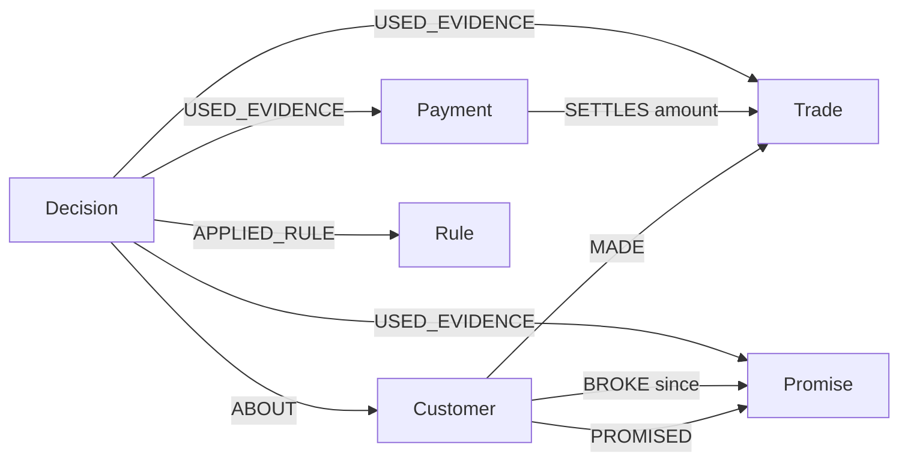

Live demo: https://bashi-vrfv.onrender.com (no sign-up)
Demo video: https://youtu.be/Xpq_LN4h9XA

# Bashi

I built Bashi for small shops that sell on credit. When a customer asks to buy on credit, Bashi answers yes or no, and it hands back a receipt that links the exact records it used: which sales, which payments, which broken promise. The answer comes from a fixed rule check over a FalkorDB graph, not from a guess, so anyone can look at the receipt and see why.

**Part of the demo data is real and part is invented.** The real part is my own shop: the 8 sales from my audit, and a separate view of my whole shop's records (45 customers, 544 sales, 543 payments), all with names removed. Everything else is invented. See "Real vs invented" below.

## Ask it from an AI tool in 30 seconds

Any AI tool that speaks MCP (a standard way for AI tools to call other tools) can ask Bashi. One call, on the practice shop, no sign-up:

```
curl -s -X POST https://bashi-vrfv.onrender.com/mcp -H "Content-Type: application/json" -d '{"jsonrpc":"2.0","id":1,"method":"tools/call","params":{"name":"decide_credit","arguments":{"customer":"C001","amount":45000,"shop":"shop_a"}}}'
```

You get back `NO`, the reason (a broken promise, PR001), the ids of the records used, a fingerprint, and a receipt link plus a verify link you can open. The call saves a decision in the practice shop, which is why it is safe to try. Setup lines for Claude Desktop are in [AGENTS.md](AGENTS.md).

## How Bashi differs

| What only Bashi does | So what | Try it |
|---|---|---|
| No model makes the yes or no. Two fixed rules do. | The same question always gets the same answer, and you can read the rules in two lines. | Read `rules.py`; "What this is not" below |
| Every answer comes with a receipt and a fingerprint. | You see the exact sales, payments and promises behind it, not just a number. | Live site, "See the real audit case" |
| Anyone can re-check a receipt later. Edit one record and the check fails. | You do not have to trust me or the database. | The four tamper commands in "The 90-second path"; `python tamper_sweep.py` runs 11 edits (11 of 11 caught, [TAMPER_SWEEP.md](TAMPER_SWEEP.md)) |
| What-if: remove one record and watch the answer flip. | You see which record decided it. It runs on a throwaway copy, so real data never changes. | Live site, "Try the demo", then "What if this evidence did not exist" |
| Real data and locked tests. | My own shop's audit (names removed), and test answers locked before I ran anything. | "Real vs invented" and "Sealed test" below |
| Agents can call it. | Another AI tool gets the answer and the receipt over plain web addresses or MCP. | The 30-second `curl` above; "Use it from other tools" |

## Why this exists

On 17 July 2026 I ran an audit (read-only) on a real shop's records. It found 8 sales marked fully paid while the customer's account ledger still showed debt, N388,340 in total. The cause: one payment updates two separate records, the sale and the ledger, and one of them can lag or fail. Each screen looks right on its own, so nobody sees the gap. I fixed the cause afterwards.

I ran the same kind of check on the same shop on 15 October 2026 (494 sales, 46 credit accounts). 3 of the 46 accounts still had two records that differ, a total gap of N15,510.

Bashi does not repair that shop's data. It is built around the same problem. It decides from linked records instead of a stored balance, shows the exact records on a receipt, flags a payment that is not linked to a sale but matches a still-open sale amount as a "possible phantom debt", and says CANNOT TRACE instead of guessing. The live demo shows that case on the real audit records, next to invented customers.

## The same problem in my whole shop, and what the graph does about it

My shop writes down every payment against the customer, never against a particular sale. So the books can tell you what a customer owes in total, but not which sale a payment cleared. That is how a sale can sit marked unpaid after the money came in: nothing connects the two.

I loaded my whole shop's record into the live site, with names removed (pick "My whole shop" in the shop list). It holds 45 customers, 544 credit sales and 543 payments. None of the 543 payments is tied to a sale.

| Plain balance check | Bashi on the same records |
|---|---|
| Credit sales N7,097,241 minus payments N6,516,828 = N580,413 owed | The same totals, but every payment is matched to a sale and each match is saved in the graph |
| One number per customer | Each sale shows whether it is cleared or still open, and which payment cleared it |
| Cannot say which sale is old and unpaid | Shows the open sales by date, so you can see who is behind |
| Cannot say why | Marks each link "inferred" and shows the rule that made it |

How the matching works. For each customer, oldest first. Rule 1: a payment equal to a whole sale clears that sale (214 links). Rule 2: what is left of a payment goes to the oldest open sale dated on or before the payment, split across sales if needed (539 links). Rule 3: money still left was paid before the sales that are open, so it is treated as a deposit on the oldest one and marked as such (20 links). Each match is saved as an `INFERRED_SETTLES` link in FalkorDB, separate from a link a person confirmed, and it is part of the receipt fingerprint, so changing one makes the check fail.

What it found, on my real records:

- 773 links in total. The total still owed after matching is N586,913, against N580,413 for the plain balance. The N6,500 gap is two accounts that paid more than they were ever sold; Bashi shows that money and does not subtract it from other people's debts.
- N130,200 across 7 accounts was recorded as paid before the sale it was applied to. It could be a real deposit or a wrong date. Bashi marks every such link and does not decide which. The biggest is one account with N111,500, and the lead button "See the account with the most money paid before the sale" opens it.
- 12 accounts still have money owed, and the receipt shows exactly which of their sales are open.

Honest limits. The matching is a rule, not a fact: nobody has confirmed these links with the customers. Rule 3 is a choice. I first made the matching stricter and refused to count money paid before a sale; the sealed test below showed that wrongly refused customers who had paid a deposit, so I changed it. Credit limits are assumed (N100,000, N300,000 or N500,000 depending on the customer's biggest sale). On a spread of questions across the 45 real accounts, Bashi's yes or no stays very close to the plain balance's, so on this shop the gain is the per-sale picture and the receipt, not a big change in answers. Where it does change answers is shown in the sealed test.

## Real vs invented

The live site opens on my own shop view (graph `shop_own`). Every record is tagged real or invented, on the page and in the data.

| | What it is |
|---|---|
| Real | The 8 credit sales from my own audit of 17 July 2026 (N388,340 in total). Each sale was recorded as paid, but the customer's ledger still showed the money as owed. The amounts still shown as owed and the sale dates come from the audit. Customers are coded CUST-A to CUST-D. |
| Real (whole shop) | The "My whole shop" view: 45 customers, 544 credit sales and 543 payments from my shop's own records, names removed. Customers are coded CUST-001 to CUST-045. Credit limits are assumed. Payment-to-sale links are inferred by rule and marked inferred. |
| Invented | 12 made-up customers (CUST-01 to CUST-12) with their sales, payments and promises, added so there is more to ask about. |
| Assumed | Credit limits for all customers, and the payment dates of the 8 real sales (set equal to the sale dates). The audit log does not hold them. The page says so. |
| Removed | Names, phone numbers, addresses, notes and item names. The data files hold only codes, amounts and dates, and the loader refuses anything else. |

This is my own shop's data, used under the hackathon rule that data may be public, synthetic or your own. A picker on the page also keeps the "Practice shop (invented data)" (graph `shop_a`: Tunde Adeyemi and 24 other invented customers), which you can also pass to the command-line tools with `--graph shop_a`.

## The 90-second path (no sign-up, nothing to install)

1. **Open the live link (about 5 seconds).** It opens on my own shop view.
2. **Press "See the real audit case" (about 20 seconds).** The receipt of the real customer with the most money wrongly showing as owed opens. It lists the exact sales and payments, and flags the payment that is not linked to a sale as a possible phantom debt.
3. **Go back and press "Try the demo", then what-if (about 25 seconds).** This asks N45,000 for an invented customer (CUST-01). The answer is NO. Open the receipt, press "What if this evidence did not exist" next to the broken promise, and the answer flips to YES on a copy of the graph. The real data is never touched.
4. **Run the tamper test (about 40 seconds).** On the site, press "See the real audit case" once so a decision is saved. Then, in a terminal with the repo set up as in "Run it" below:

```powershell
python tamper.py TR-2 300000 --graph shop_own
python verify.py --graph shop_own     # FAIL, names Trade TR-2
python tamper.py --restore --graph shop_own
python verify.py --graph shop_own     # PASS
```

## Tracks entered

- **Track 01, Agents That Act on Connected Data (lead).** The agent answers a credit question from linked records in the graph, saves the decision back into the graph, and the receipt shows the exact records it used.
- **Track 02, Agent Memory and Coordination.** Decisions and promises to pay are stored in the graph and survive restarts. A promise written in plain words ("Tunde promises N10,000 by Friday") becomes a node that the next decision for that customer reads. Stored decisions can be replayed later with `python verify.py`. The only hand-off is between the language step (picks lookups, words one sentence) and the fixed rule check, which makes the decision. It is not several agents talking to each other.

## How it works

- Customers, sales, payments and promises to pay live as a graph in FalkorDB.
- A payment is linked to the sale it settles, so a sale that was already paid is never counted twice.
- The rule: say no if what the customer owes plus the new request is over their limit, or if they broke a promise to pay.

A promise to pay that is still unkept after its due date counts as broken the next time Bashi checks that customer. The check runs before every decision and never touches a promise marked kept. A saved decision remembers the day it was made, so replaying it later does not change just because time passed.

## Where FalkorDB is needed

The answer is a walk over links, so the graph is the product:

- A payment is linked to the sale it settles `(Payment)-[:SETTLES]->(Trade)`. Open debt is the sales a customer made minus the payments linked to them. Without the link, a payment cannot be matched to the right sale.
- A customer is linked to the promises they made and the ones they broke `(Customer)-[:PROMISED]->(Promise)`, `(Customer)-[:BROKE]->(Promise)`.
- Every decision is saved as a node with `USED_EVIDENCE` links to the exact sales, payments and promises it read. The receipt page reads those links back and shows those records, nothing else.
- The what-if button uses FalkorDB's `GRAPH.COPY` to copy the whole graph, delete one record on the copy, ask again, and delete the copy.
- The receipt reads one customer's records in a single combined query (it used to be four).

Stop FalkorDB and Bashi answers nothing. There is no local copy of the data to fall back on.

## Graph data model

Two graphs use this same model. `shop_own` is the default on the live site (8 real audited sales plus invented customers, every record tagged real or invented). `shop_a` is the practice shop (25 invented customers), used by `seed.py`. `verify.py` and `tamper.py` take `--graph` and use `shop_own` when it is loaded. Every node has an `id` and an index on it.



| Node | What it is | Properties |
|---|---|---|
| Customer | a shop customer | id, name, credit_limit, synthetic, source (`shop_own`); phone (`shop_a`) |
| Trade | one credit sale | id, amount, date, item |
| Payment | money received | id, amount, date |
| Promise | a promise to pay | id, date, due, amount, kept |
| Rule | one of the two rules | id, text |
| Decision | one saved yes or no | id, customer_id, request, verdict, reason, created, as_of, open_debt, fingerprint, rule_ids, snapshot |
| Counter | hands out the next D0001 or PR004 id | id, n |

| Link | Meaning | Link properties |
|---|---|---|
| `(Customer)-[:MADE]->(Trade)` | the customer bought on credit | none |
| `(Payment)-[:SETTLES]->(Trade)` | this payment paid all or part of this sale | `amount`: how much of the payment went to this sale |
| `(Customer)-[:PROMISED]->(Promise)` | the customer promised to pay | none |
| `(Customer)-[:BROKE]->(Promise)` | the promise is unkept and past its due date | `since`: the day the link was added (seeded ones have none) |
| `(Decision)-[:ABOUT]->(Customer)` | who the decision was for | none |
| `(Decision)-[:USED_EVIDENCE]->(Trade, Payment or Promise)` | a record the decision read | none |
| `(Decision)-[:APPLIED_RULE]->(Rule)` | the rules applied | none |

The practice seed (`seed.py`) builds 25 customers and 120 credit sales, 30 of them unpaid or part paid. One payment for customer C002 is left unlinked on purpose, to show the phantom-debt warning.

## Key Cypher queries

These are copied from the code. In plain words, "open debt" is all of a customer's sales minus the payment amounts linked to them.

**1. Open debt walk** (`rules.py`, `read_state`). One round trip gets the customer, their sales with the payments settling each (if any), their promises and their broken promises. The code then adds it up: open debt = sum of sale amounts minus sum of `SETTLES.amount` (`evaluate`, same file). The sales-and-payments part:

```cypher
MATCH (c:Customer {id:$cid})-[:MADE]->(t:Trade)
OPTIONAL MATCH (p:Payment)-[s:SETTLES]->(t)
RETURN t.id, t.amount, t.date, p.id, p.amount, p.date, s.amount
```

The same debt as one Cypher sum, used as a seed check for Tunde (`seed.py`, `main`):

```cypher
MATCH (:Customer {id:'C001'})-[:MADE]->(t:Trade)
OPTIONAL MATCH (:Payment)-[s:SETTLES]->(t)
WITH t, coalesce(sum(s.amount),0) AS paid RETURN sum(t.amount - paid)
```

**2. Broken promises** (`rules.py`, `mark_overdue_promises`). Links every customer to each promise that is unkept and past its due date. Running it twice changes nothing, and kept promises are never touched. The decision then reads the `BROKE` links in query 1.

```cypher
MATCH (c:Customer)-[:PROMISED]->(p:Promise)
WHERE p.kept = false AND p.due < $today
MERGE (c)-[b:BROKE]->(p) ON CREATE SET b.since = $today
```

**3. Evidence save** (`rules.py`, `_save`). Stores the decision, then one `USED_EVIDENCE` link for every sale, payment and promise it read (the label changes per record), then the rules it applied.

```cypher
MATCH (c:Customer {id:$cid})
CREATE (d:Decision {id:$did, customer_id:$cid, request:$req, verdict:$v, reason:$reason,
  created:$created, fingerprint:$fp, rule_ids:$rids, snapshot:$snap, open_debt:$debt, as_of:$as_of})
CREATE (d)-[:ABOUT]->(c)

MATCH (d:Decision {id:$did}), (e:Trade {id:$eid}) CREATE (d)-[:USED_EVIDENCE]->(e)
MATCH (d:Decision {id:$did}), (r:Rule {id:$rid}) CREATE (d)-[:APPLIED_RULE]->(r)
```

**4. Orphan payment check** (`rules.py`, `possible_phantoms`). Finds payments linked to no sale. If one has the same amount as a still-open sale, the receipt warns about a possible phantom debt. The debt is never changed.

```cypher
MATCH (p:Payment) WHERE NOT (p)-[:SETTLES]->() RETURN p.id, p.amount, p.date
```

**5. What-if** (`whatif.py`, `whatif`). Copies the whole graph with FalkorDB's `GRAPH.COPY` (called as `graph.copy(name)`), deletes the chosen record on the copy only, asks again on the copy, then deletes the copy.

```cypher
GRAPH.COPY shop_a shop_a_whatif_<decision id>_<time>_<random>
MATCH (n) WHERE n.id = $i AND (n:Trade OR n:Payment OR n:Promise) DETACH DELETE n   // on the copy
GRAPH.DELETE shop_a_whatif_<decision id>_<time>_<random>
```

Also in `rules.py`: `allocate_id` bumps the id counter in the graph with `MATCH (k:Counter {id:$k}) SET k.n = k.n + 1 RETURN k.n`, so two requests never get the same id. `agent.py` `record_promise` writes the promise from plain words:

```cypher
MATCH (c:Customer {id:$cid})
CREATE (c)-[:PROMISED]->(:Promise {id:$pid, date:$d, due:$due, amount:$amt, kept:false})
```

## What this is not

- **Not tamper-proof.** The replay is tamper-evident. If something changes a sale, a payment or a decision, the replay shows it. But anyone who can write to the database can rewrite a decision and its fingerprint together, and the replay would pass.
- **Not a smart credit score.** The yes or no comes from a fixed rule, two lines long, simple on purpose: say no if the debt plus the request is over the limit, or if there is a broken promise. No model decides it.
- **Not an AI that decides.** The AI only picks which lookups to run and words one sentence. Every number and name in that sentence is checked against the records, and if the check fails, a plain template answers instead.
- **Not far more accurate than a balance check.** On the scorecard below, Bashi gives the same answer as a balance-only check on 37 of 40 questions and a different one on 3. The gain is the receipt and the trace, not a bigger accuracy number.
- **Not a full set of real data.** Only 8 sales are real, and credit limits and payment dates for them are assumed. The rest is invented, so nothing here is advice about a real person or a real debt. Bashi does not repair that shop's data.

## Run it

You need Python 3 (the hosted site uses 3.13) and a FalkorDB instance. I use the free FalkorDB Cloud one. To run FalkorDB on your own machine instead, start FalkorDB's standard Docker image (`docker run -p 6379:6379 falkordb/falkordb`) and use host `localhost`, port `6379` and no username or password below.

```powershell
git clone https://github.com/Sireadell/bashi
cd bashi
pip install -r requirements.txt
```

Copy `.env.example` to `.env`, fill in your connection details (never commit it). The two AI keys are optional: without one, the plain-words box uses a built-in parser and fixed wording, and every reply says which mode answered. If both are set, Claude is used first.

```
FALKORDB_HOST=your-host
FALKORDB_PORT=your-port
FALKORDB_USERNAME=your-username
FALKORDB_PASSWORD=your-password
ANTHROPIC_API_KEY=optional
GEMINI_API_KEY=optional
```

Build the practice shop (wipes and rebuilds the graph `shop_a`, takes a few seconds; `python own_shop.py` does the same for `shop_own`):

```powershell
python seed.py
```

Ask from the command line. Tunde asks for N45,000 and gets a NO because of one broken promise:

```powershell
python rules.py C001 45000
```

Start the site and open http://127.0.0.1:5000. On the practice shop, press "Try the Tunde demo":

```powershell
python app.py
```

`verify.py` and the tamper test need at least one saved decision. On a fresh graph, ask once first (`python rules.py CUST-B 10000 --graph shop_own`, or press the demo button), then run the tamper test above. Hosting steps are in `DEPLOY.md`.

## Honest edge cases

To replay every saved decision at any time, run `python verify.py` (add `--graph shop_a` for the practice shop).

If removing the evidence changes nothing, the page says so instead of pretending it mattered. If an amount cannot be traced to a sale and a payment, Bashi says it cannot trace it and gives no number.

## Against the plain alternatives

Most small shops use one of two things: a notebook or spreadsheet ledger, or a balance check (add up the sales, subtract the payments, compare with the limit). Both give one number. Neither shows which sale a payment settled, and neither knows about a broken promise.

On the 8 real audit sales (names removed), the shop's own ledger showed N388,340 owed. A balance check reads that number and stops there. Bashi walks from each sale to the payments linked to it, and for all 8 it finds a payment of the same amount that was recorded but never linked. It flags each one as a possible phantom debt and does not change the debt. You can see this on the live site with "See the real audit case".

| Customer (real, coded) | Sales flagged | Unlinked payments found | Amount |
|---|---|---|---|
| CUST-A | TR-1, TR-6 | N1,280 and N50 | N1,330 |
| CUST-B | TR-2, TR-3, TR-4 | N224,960, N47,500, N70,750 | N343,210 |
| CUST-C | TR-5, TR-7 | N200 and N100 | N300 |
| CUST-D | TR-8 | N43,500 | N43,500 |
| **Total** | **8 of 8** | | **N388,340** |

Honest limit: the amounts and sale dates come from my audit, but the payment records in the demo graph are rebuilt from it, and their dates are assumed. So this shows what Bashi does with records shaped like the audit finding. It does not prove those customers paid.

## Claims and how to check them

| Claim | How to check it |
|---|---|
| The 8 real audit sales add up to N388,340 and all 8 are flagged | Open the live site, press "See the real audit case", read the receipt |
| A broken promise turns a YES into a NO, and removing it flips the answer back | Live site: "Try the demo", open the receipt, press "What if this evidence did not exist" |
| The real data is never changed by the what-if | The what-if runs on a copy of the graph; read `whatif.py`, or ask twice and compare receipts |
| A tampered record is caught on replay | Run the four tamper commands in "The 90-second path" |
| Bashi gives the same answer as a balance check on 37 of 40 questions | `python scorecard.py`, then read `scorecard_results.json` |
| The yes or no contains no AI | Read `rules.py`; no model is called inside `decide` |
| A model sentence that fails the check is replaced | Read `agent.py`; the reply says which mode answered |
| Every record on the page is tagged real or invented | Look at the tags on the live pages and in `own_audit_seed.py` |
| On 255 cases whose answers were locked first (55, then 200 new), Bashi never wrongly approves; a balance check wrongly approves 53 | `python sealed/run_sealed.py` and `python sealed/run_sealed.py b` (each checks its hash first), then read `sealed/RESULTS.md` and `sealed/RESULTS_B.md` |
| 11 different edits to a saved decision's records are all caught, and each passes again once undone | `python tamper_sweep.py` (runs on a throwaway copy of the practice shop), then read `TAMPER_SWEEP.md` |
| The tests pass | `python -m pytest` (about 20 minutes, it talks to a hosted database) |
| The audit figures (N388,340, 494 sales, 46 accounts) are from my shop | A visitor cannot check these. They are my own read-only audit, names removed. |

## Use it from other tools

Another AI app can ask Bashi "can customer X take N naira on credit?" and get a YES or NO with a receipt link it can re-check later. There are plain web addresses and an MCP address (MCP is a standard way for AI tools to plug into other tools). The answer is still the same two fixed rules, with no AI in the decision. Full guide with one example per address: [AGENTS.md](AGENTS.md).

| Address | What it does |
|---|---|
| `POST /api/decide` | Body `{"customer": "C001", "amount": 45000, "shop": "shop_a"}` (C001 is in the practice shop; leave `shop` out to use the default shop). Returns the answer, reasons, receipt link, verify link and the records used. |
| `GET /api/receipt/<id>` | The full receipt as data. |
| `GET /api/verify/<id>` | Re-checks one saved decision and returns `verified` true or false. |
| `GET /api/whatif/<id>?remove=<record id>` | The answer if that record had never existed, run on a throwaway copy. |
| `POST /mcp` | MCP tools: `decide_credit`, `get_receipt`, `verify_decision`, `what_if_remove_evidence`, `list_customers`. `python mcp_stdio.py` gives the same tools for Claude Desktop. |

Tests: `python -m pytest tests/test_api_mcp.py -q`.

One-click install for Claude Desktop: [extension/Bashi.mcpb](extension/Bashi.mcpb), steps in [extension/INSTALL.md](extension/INSTALL.md). It talks to the live site, so there is nothing to set up. Tested with a protocol-level MCP client over both the web address and stdio (all five tools, including error cases); also installed and tried inside Claude Desktop (C001 for N45,000 gave NO because of broken promise PR001).

## Beyond shops

Bashi only does shop credit today. The pattern is not shop-specific: fixed rules over linked records, a receipt that names the records, and a replay that catches edits. The same pattern would fit these, each with its own two or three rules (not built yet):

| Use | Records it links | A rule it could check |
|---|---|---|
| Landlord or estate | Rent due, payments, promised dates | Arrears over a limit, or a broken promise to pay |
| Small lender or savings group | Loans, repayments, promises | Open balance plus the new loan is over the limit |
| Supplier giving trade credit | Invoices, payments, delivery notes | Unpaid invoices over a limit |
| School fees | Fees, payments, payment plans | Balance over a limit, or a missed plan date |

## Use it on your own shop

You can run Bashi on your own records without sending anything to the public demo. Put three CSV files in a folder (first line is the column headings, dates are `YYYY-MM-DD`, amounts are whole naira). A tiny invented example is in [examples/my_shop_csv](examples/my_shop_csv).

| File | Columns |
|---|---|
| `customers.csv` | `id`, `name`, `credit_limit` |
| `sales.csv` | `id`, `customer_id`, `amount`, `date`, `item` |
| `payments.csv` | `id`, `customer_id`, `amount`, `date`, `sale_id` (leave `sale_id` empty if you do not know which sale it paid) |
| `promises.csv` (optional) | `id`, `customer_id`, `amount`, `date`, `due`, `kept` (yes or no) |

```powershell
python import_csv.py --dir examples/my_shop_csv --graph my_shop
python ask_csv.py --graph my_shop C001 45000
python verify.py --graph my_shop
```

It loads into YOUR own FalkorDB, using the settings in your `.env`. It never writes to the public demo, and it refuses the graph names `shop_a`, `shop_own` and `shop_real`. The graph name must be new unless you add `--replace`. Every row is checked first: if any row is bad, it lists each problem with its row number and writes nothing. A payment with no `sale_id` is matched to that customer's sales by the same rule the real shop view uses, and shown as inferred. The decision is still the same two fixed rules (debt over the limit, or a broken promise), with a receipt you can re-check.

## Sealed test

The scorecard below is small and runs on invented data, so I added a harder exam. I wrote 55 shop-credit cases built around the situations Bashi exists for: payments never tied to a sale, broken promises, deposits paid before a sale, sales with no amount, and one customer's payment that must not clear another customer's sale. Each case has the correct answer, worked out by plain arithmetic from the story of the case (not by Bashi's code). I locked the answers by hashing them and pushed the hash (commit `977f5bd`, [sealed/KEY_HASH.txt](sealed/KEY_HASH.txt)) before running anything on them. Re-run it with `python sealed/run_sealed.py`; it refuses to run if a single answer changed. Full reports: [sealed/RESULTS.md](sealed/RESULTS.md) (after the fix) and [sealed/RESULTS_run1.md](sealed/RESULTS_run1.md) (before it).

| Method | First run | After I changed one rule | Wrongly approved | Naira wrongly approved |
|---|---|---|---|---|
| Plain balance check | 41 of 55 | 41 of 55 | 14 | N258,001 |
| Bashi, confirmed links only | 47 of 55 | 47 of 55 | 0 | N0 |
| Bashi with payment matching | 51 of 55 | 55 of 55 | 0 | N0 |

Where Bashi wins: all 7 broken-promise cases and all 4 missing-amount cases. The balance check misses every one of them and says yes. Bashi never wrongly approved a customer in either run.

What changed between the two runs, and why it is not a clean result. The first run showed one weakness: the 4 "deposit paid before the sale" cases. My matching rule would not let a payment clear a later sale, so Bashi refused customers who had in fact paid up front (the balance check got those right). I changed the rule so that money paid before a sale is applied to the oldest open sale as a deposit, clearly marked. That brought the 4 cases right. Because I changed the rule after seeing the answer, the second column is not an independent exam. It shows the fix works on the cases that exposed the problem; the first column is the sealed result.

### A second, untouched exam: 200 cases

The 55 cases above are where I fixed the deposit rule, so they are no longer a fair exam for it. I then generated a second set of 200 cases from a fixed seed ([sealed/make_key_b.py](sealed/make_key_b.py)), with the answers worked out by plain arithmetic from each story, and pushed its fingerprint first (commit `a5e2bd8`, [sealed/KEY_HASH_B.txt](sealed/KEY_HASH_B.txt)). Bashi's rules were not changed after that. Re-run it with `python sealed/run_sealed.py b`. Report: [sealed/RESULTS_B.md](sealed/RESULTS_B.md).

| Method | 55 cases (rule fixed on these) | 200 new cases | Wrongly approved on the 200 |
|---|---|---|---|
| Plain balance check | 41 | 161 | 39 (N3,970,000) |
| Bashi, confirmed links only | 47 | 190 | 0 |
| Bashi with payment matching | 55 | 200 | 0 |


What this tells you, plainly:
- The 200 cases are generated from templates. They vary amounts, dates and mixes of situations, not the kinds of situation. 200 of 200 on tidy templated cases is not a claim about real shops.

What this test is not. I wrote the cases and I wrote Bashi, so I was not blind to how it behaves. I did not include reversed or refunded sales (Bashi cannot record a reversal yet). A bug in the matching code on sales with no amount showed up while running the first set; I fixed it and added a test, and the cases and the hash were not touched.

## Scorecard

Bashi against a plain "balance only" answer (all sales minus all payments, plus the request, against the limit; it ignores which sale a payment settles and ignores broken promises). 40 questions on the seeded shop: every one of the 25 customers once, 15 repeats, amounts spread between 30% and 130% of each limit (seed 42), plus Tunde at N45,000. Nothing is saved to the graph.

| | Count |
|---|---|
| Questions | 40 |
| Same answer | 37 |
| Different | 3 |

| Customer | Request | Bashi | Balance only | Why |
|---|---|---|---|---|
| C001 Tunde Adeyemi | N45,000 | NO | YES | broken promise PR001 |
| C002 Amaka Obi | N24,000 | NO | YES | a N12,000 payment was never linked to its sale |
| C007 Funke Balogun | N30,000 | NO | YES | broken promise PR006 |

The scorecard runs on the invented practice shop, and only 3 of 40 differ, so this is a small gap. It is the gap Bashi is built for: the balance says yes where a broken promise or an unlinked payment says otherwise. Re-run it with `python scorecard.py` (writes `scorecard_results.json`).

## Tests

```powershell
python -m pytest
```

There are 159 tests. The full run takes about 20 minutes because it talks to a hosted database. The tests run against a copy of the graph and delete it afterwards.

## AI tools used

- **Claude Code (Anthropic)** was used to build this project: the code, tests and documentation.
- **At run time, Claude (a Haiku model) or Gemini**, only if you set a key, and only for two jobs: choosing which lookups to run and wording one short sentence. They never make the yes or no. The rule check (`rules.py`) contains no AI, and a model sentence that fails the check against the records is replaced by fixed wording.
